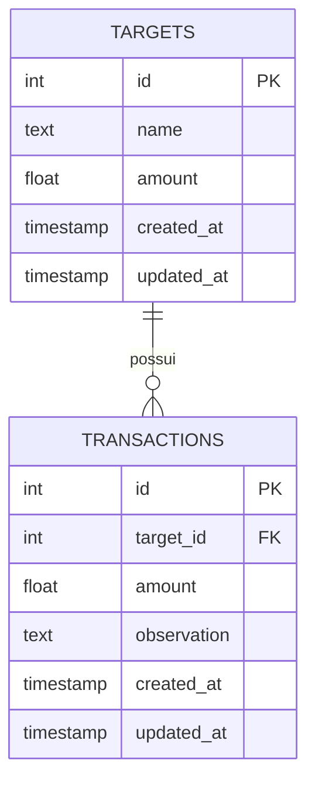

<div align="center">


# 🎯 Target

**Suas metas financeiras na palma da mão.**<br/>
Crie objetivos de economia, registre cada depósito e retirada e acompanhe quanto falta para chegar lá.


</div>

---

## 📑 Sumário

- [Sobre](#-sobre)
- [Funcionalidades](#-funcionalidades)
- [Tecnologias](#-tecnologias)
- [Como funciona o banco](#%EF%B8%8F-como-funciona-o-banco)
- [Estrutura](#-estrutura)
- [Rodando o projeto](#-rodando-o-projeto)
- [Padrões de código](#-padr%C3%B5es-de-c%C3%B3digo)

## 💡 Sobre

O **Target** ajuda a juntar dinheiro para um objetivo: uma viagem, uma reserva de emergência, um carro. Cada meta tem um valor-alvo, e cada transação aproxima (ou afasta) você dele. Tudo fica salvo **no próprio aparelho**, em SQLite: não precisa de internet nem de conta.

## ✨ Funcionalidades

| | Funcionalidade | Detalhes |
| :---: | --- | --- |
| 📊 | **Resumo** | total guardado, soma das entradas e soma das saídas na tela inicial |
| 🏁 | **Metas** | criar, editar e excluir, com a lista ordenada pelas mais perto de serem concluídas |
| 📈 | **Progresso** | barra de progresso com valor atual, valor da meta e porcentagem |
| 💸 | **Transações** | depósito ou retirada, valor com máscara em R$ e motivo opcional |
| 🕓 | **Histórico** | todas as transações da meta, com data e hora |
| 🗑️ | **Remoção segura** | confirmação antes de apagar; ao excluir uma meta, as transações dela vão junto |

## 🛠 Tecnologias

| Categoria | Tecnologia |
| --- | --- |
| Base | React Native 0.79 · Expo SDK 53 · TypeScript |
| Navegação | Expo Router (rotas por arquivo) |
| Dados | expo-sqlite, com migração na inicialização |
| Interface | Fonte Inter · expo-linear-gradient · react-native-currency-input |
| Utilitários | Day.js |
| Qualidade | ESLint · Prettier |

## 🗄️ Como funciona o banco

O banco `target.db` é criado na primeira execução:



- O **valor atual** e a **porcentagem** de cada meta são calculados direto na consulta, somando as transações.
- As **retiradas** são salvas como valores negativos.
- A chave estrangeira usa `ON DELETE CASCADE`: apagar a meta apaga as transações dela.

## 🗂 Estrutura

```
src/
├── app/                 # telas (Expo Router)
│   ├── _layout.tsx      # fontes, SQLiteProvider e navegação
│   ├── index.tsx        # início: resumo e lista de metas
│   ├── target.tsx       # criar ou editar meta
│   ├── in-progress/     # detalhes da meta e transações
│   └── transaction/     # nova transação
├── components/          # Button, CurrencyInput, Progress, List, Transaction…
├── database/            # migração e hooks de acesso ao SQLite
├── theme/               # cores e fontes
└── utils/               # formatação de moeda e tipos de transação
```

## 🚀 Rodando o projeto

> [!NOTE]
> O app usa um *development build*, então é preciso ter o **Android Studio** ou o **Xcode** instalados.

```bash
# 1. clone o repositório
git clone https://github.com/RicardoBaldrez/Target.git
cd Target

# 2. instale as dependências
npm install

# 3. compile e abra no emulador ou no aparelho
npm run android   # ou: npm run ios
```

Depois do primeiro build, `npm start` sobe só o servidor de desenvolvimento.

### 📜 Scripts

| Comando | O que faz |
| --- | --- |
| `npm start` | servidor de desenvolvimento (dev client) |
| `npm run android` / `npm run ios` | compila e abre no emulador ou no aparelho |
| `npm run lint` / `npm run lint:fix` | verifica ou corrige o código com ESLint |
| `npm run format` / `npm run format:check` | formata ou verifica com Prettier |

### 🔍 Acessando o banco no simulador iOS

```bash
xcrun simctl get_app_container booted com.ricardob.target data
```

O arquivo fica em `[caminho_retornado]/Documents/SQLite/target.db` e pode ser aberto no **Beekeeper Studio**, no **DB Browser for SQLite** ou no **DBeaver**.

## 🧹 Padrões de código

ESLint e Prettier com formatação e correção automáticas ao salvar no VS Code (configuração em `.vscode/settings.json`). As principais regras:

- ✅ imports organizados por grupos e em ordem alfabética;
- ✅ indentação de 2 espaços e linha vazia no fim de cada arquivo;
- ✅ sem estilos inline (`react-native/no-inline-styles`);
- ✅ cores sempre vindas do tema (`react-native/no-color-literals`).

---

<div align="center">

Feito por **Ricardo Baldrez** 👋

[](https://ricardobaldrez.vercel.app)
[](https://www.linkedin.com/in/ricardo-barbosa-baldrez-38b760145)

</div>
